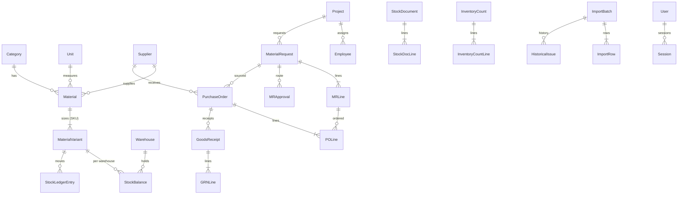

# Arxitektura

## Stack və səbəbləri

| Qat | Seçim | Niyə |
|---|---|---|
| Veb | **Next.js 15 (App Router) + React 19 + TypeScript** | Server Components: məlumat serverdə oxunur, brauzerə yalnız HTML gedir (sürətli, az JS). Server Actions: bütün yazma əməliyyatları serverdə, avtomatik Origin/CSRF yoxlaması |
| Stil | **Tailwind CSS 4** + öz komponent sistemi (`globals.css` tokenləri) | Bir token mənbəyi, light/dark, səhifəyə xas stil yoxdur. shadcn/ui əvəzinə eyni yanaşmada yüngül öz komponentlər (`src/components`) — daha az asılılıq |
| DB | **PostgreSQL 16 + Prisma 6** | Tranzaksiya, row-lock, CHECK constraint, trigger, pg_trgm axtarışı. Prisma: tip-təhlükəsiz sorğular + migrasiya |
| Validasiya | **Zod** | Server-side sxemlər, AZ dilində xəta mesajları |
| Auth | Öz sessiya modulu (bcrypt, DB sessiyaları, httpOnly cookie) | Auth.js-in bu ssenaridə (yalnız e-poçt/parol, RBAC) əlavə dəyəri yoxdur; daha az hərəkətli hissə |
| Excel | **ExcelJS** | xlsx/xlsm oxuma (makro icra etmir), export |
| Test | Vitest (unit + real PostgreSQL inteqrasiya), Playwright (e2e) | |

Mövcud repozitoriya yox idi; mövcud HTML yalnız istinad kimi istifadə olundu.

## Qatlar

```
src/app/(app)/**/page.tsx        Server Components — oxuma, icazə yoxlaması (requirePage)
src/app/(app)/**/actions.ts      Server Actions — runAction(): auth + RBAC + xəta tutma + revalidate
src/server/services/*.ts         Biznes qaydaları (Next-dən asılı deyil, testlərdə birbaşa çağırılır)
src/server/stock/ledger.ts       Stoku yazan YEGANƏ kod yolu (applyMovements)
src/server/stock/rules.ts        Saf qaydalar (unit test)
src/server/import/*              Excel import (oxuma, normallaşdırma, preview, commit, rollback)
prisma/schema.prisma + migrations  Sxem + DB səviyyəli qoruyucular (CHECK, trigger)
```

## Stock ledger qaydaları

- `stock_ledger` **append-only**: `UPDATE/DELETE/TRUNCATE` DB trigger-i ilə qadağandır (`HEC_APPEND_ONLY`).
- Hər qeyd: növ, anbar, variant, miqdar (>0), sənəd növü/ID/sətir/nömrə, layihə, işçi, tarix, istifadəçi, səbəb, **unikal idempotency key**, `reversalOfId`.
- `stock_balances` = proyeksiya; ledger yazıldığı **eyni tranzaksiyada** yenilənir. CHECK: `onHand ≥ 0`, `reserved ≥ 0`, `reserved ≤ onHand`.
- `on_hand = Σ(OPENING, RECEIPT, RETURN_IN, TRANSFER_IN, ADJUSTMENT_PLUS) − Σ(ISSUE, RETURN_OUT, TRANSFER_OUT, ADJUSTMENT_MINUS)`
- `available = on_hand − reserved` (RESERVATION / RESERVATION_RELEASE yalnız `reserved`-ə təsir edir).
- `project_issued(net) = Σ ISSUE − Σ RETURN_IN` (projectId üzrə).
- Karantin anbarları (`type = QUARANTINE`) mövcud qalığa/dashboarda daxil edilmir.

### Posting alqoritmi (`applyMovements`)
1. Balans sətirləri yoxdursa `INSERT … ON CONFLICT DO NOTHING`.
2. `SELECT … FOR UPDATE` — **sıralanmış** (anbar, variant) ardıcıllığı ilə (deadlock olmur).
3. Hər açar üzrə hərəkətlər sənəd ardıcıllığı ilə tətbiq edilir; çıxış `available`-ı yoxlayır.
4. Ledger `createMany`, balans `UPDATE`.
5. Hər sənəd postingi əvvəlcə sənəd sətrini `FOR UPDATE` kilidləyir: status artıq `POSTED`-dirsə **heç nə yazmadan** `{alreadyPosted:true}` qaytarır (double-click, retry, iki tab).
6. `withTx` deadlock/serialization/bağlantı kəsilməsini avtomatik təkrarlayır (jitter backoff).

### Sənədlər və statuslar
| Sənəd | Statuslar | Ledger |
|---|---|---|
| InventoryCount (OPENING / CYCLE) | DRAFT → POSTED / CANCELLED | OPENING (yalnız hərəkətsiz variant) / ADJUSTMENT± (fərq) |
| StockDocument: ISSUE_PROJECT, ISSUE_EMPLOYEE | DRAFT → POSTED → REVERSED | ISSUE (+projectId, +employeeId) |
| RETURN_FROM_PROJECT / RETURN_FROM_EMPLOYEE | eyni | RETURN_IN (xalis veriləndən çox ola bilməz; qüsurlu → karantin) |
| RETURN_TO_SUPPLIER | eyni | RETURN_OUT |
| TRANSFER | eyni | TRANSFER_OUT + TRANSFER_IN |
| ADJUSTMENT | eyni (təsdiq: anbar müdiri) | ADJUSTMENT± |
| GoodsReceipt (GRN) | DRAFT → POSTED → REVERSED | RECEIPT (qəbul − rədd) |
| Reservation | ACTIVE → RELEASED | RESERVATION / RELEASE |

Tapşırıqdakı `Issue`, `IssueLine`, `Return` obyektləri **`StockDocument` + `StockDocLine`** cədvəlində `kind` ilə saxlanılır (eyni posting/reversal məntiqi, daha az kod). Layihəyə ümumi məxaric və işçiyə PPE **ayrı növlərdir** — eyni ədəd bir dəfə ledger-ə düşür; işçi təhvili işçinin layihəsinə də aid edilir.

### Satınalma
MR (DRAFT → SUBMITTED/UNDER_REVIEW → APPROVED / RETURNED / REJECTED → PARTIALLY/FULLY_ORDERED → PARTIALLY_DELIVERED/DELIVERED, CANCELLED). Təsdiq mərhələləri `approval_step_config`-dən (admin redaktə edir), şərtlər: həmişə / təcili və ya PM limiti / GD limiti. Ardıcıl təsdiq, rol yoxlaması.
PO yalnız orderable MR-dan (istisna: `po.override` + səbəb, audit). PO sətri kataloq variantına bağlıdır; MR net miqdarından çox sifariş bloklanır.
GRN posting: PO sətirləri kilidlənir, artıq qəbul (tolerans 0%) bloklanır, `qtyReceived` proyeksiyası, PO və MR statusu avtomatik.

## ERD (sadələşdirilmiş)



Bütün cədvəllər: `prisma/schema.prisma`. Xüsusi SQL: `prisma/migrations/*_init/migration.sql` sonu (CHECK, trigger, trigram və partial indekslər, idempotent import üçün partial unique index).

## RBAC

| İcazə | SA | Anbar müdiri | Anbardar | Satınalma | Layihə rəhbəri | Auditor |
|---|:-:|:-:|:-:|:-:|:-:|:-:|
| Görmə (qalıq, kataloq, hesabat) | ✓ | ✓ | ✓ | ✓ | ✓ | ✓ |
| Kataloq idarəsi | ✓ | ✓ | | | | |
| Sayım yaratma / təsdiq | ✓/✓ | ✓/✓ | ✓/– | | | |
| Məxaric/qaytarma/köçürmə: qaralama, təsdiq | ✓ | ✓ | ✓ | | | |
| Qalıq düzəlişi təsdiqi, reversal, təyinat override | ✓ | ✓ | | | | |
| MR yaratma | ✓ | ✓ | ✓ | ✓ | ✓ | |
| MR mərhələ təsdiqi | konfiqurasiya olunan rollar ||||||
| PO idarə / təsdiq | ✓ | | | ✓ | | |
| PO istisnası (MR-siz) | ✓ | | | | | |
| GRN qaralama / təsdiq | ✓ | ✓ | ✓ | | | |
| Excel import | ✓ | ✓ | | | | |
| Audit jurnalı | ✓ | ✓ | | | | ✓ |
| İstifadəçilər, təsdiq marşrutu | ✓ | | | | | |

Hər server action və səhifə serverdə yoxlayır (`requireUser(perm)` / `requirePage(perm)`); servislər də öz daxilində `can()` yoxlayır (testlər bunu API qatından asılı olmadan təsdiqləyir).

## Etibarlılıq ("sistem çökməsin")

| Risk | Tədbir |
|---|---|
| Səhv kod qalığı pozur | DB CHECK + append-only trigger + posted sətir kilidi (DB səviyyəsində) |
| Eyni anda iki əməliyyat | Row lock (`FOR UPDATE`), sıralı kilid, idempotent posting |
| Deadlock / bağlantı kəsilməsi | `withTx` avtomatik təkrar (5 dəfə, backoff) |
| Server xətası UI-ı çökdürür | `runAction` heç vaxt throw etmir; `error.tsx`, `global-error.tsx` sərhədləri; istifadəçiyə AZ mesaj, texniki detal yalnız server logunda |
| Unhandled promise rejection prosesi öldürür | `instrumentation.ts` — loglanır, server işləməyə davam edir |
| Proses dayanır / donur | `scripts/start.mjs` supervisor: avtomatik restart (backoff) + `/api/health` heartbeat; Docker `restart: unless-stopped` + healthcheck |
| DB uzun sorğu / asılı tranzaksiya | tranzaksiya timeout 30s, `idle_in_transaction_session_timeout=60s` |
| Məlumat itkisi | gündəlik `pg_dump` (30 gün), `npm run backup`; ledger dəyişməz olduğu üçün tam tarixçə saxlanılır |
| Ledger ↔ qalıq uyğunsuzluğu | `/api/health?deep=1` yoxlayır; testlərdə `projectionMismatches()` |

## Sürət

- Qalıq hesablamaq üçün ledger cəmlənmir — `stock_balances` proyeksiyası oxunur.
- İndekslər: ledger (variant+anbar, layihə+variant, sənəd, tarix, növ+tarix), pg_trgm GIN (ad, kod, model, SKU, işçi adı), partial (aktiv rezerv, açıq PO).
- Server-side səhifələmə (50–100 sətir), bütün siyahılar URL parametrləri ilə serverdə filtrlənir.
- Ölçülmüş (12 000 variant, ~36 000 ledger qeydi, lokal PostgreSQL): dashboard 50 ms, qalıq səhifəsi 63 ms, axtarış 33–38 ms, jurnal 22 ms (`tests/integration/perf.test.ts`).

## Təhlükəsizlik
- bcrypt(12), sessiya tokeni yalnız SHA-256 hash kimi DB-də, httpOnly + SameSite=Lax (+Secure HTTPS-də), 5 uğursuz cəhd → 15 dəq blok, IP throttle, istifadəçi sayımının qarşısını alan sabit vaxt.
- CSRF: Server Actions Origin yoxlaması; GET endpoint-lər yan təsirsizdir.
- XSS: React escaping; `dangerouslySetInnerHTML` yoxdur; CSP başlığı.
- Injection: Prisma parametrləşdirilmiş sorğular (`$queryRaw` tagged template).
- IDOR: hər obyekt üçün server-side icazə; ID-lər UUID və format yoxlaması.
- Excel formula injection: export-da `= + - @` ilə başlayan dəyərlərə `'` prefiksi.
- Fayl yükləmə: yalnız xlsx/xlsm, ZIP imza yoxlaması, 25 MB, hash adı ilə saxlanılır, makro icra edilmir.
- Real parol kodda yoxdur; ilk admin env dəyişənindən bir dəfə yaradılır.
